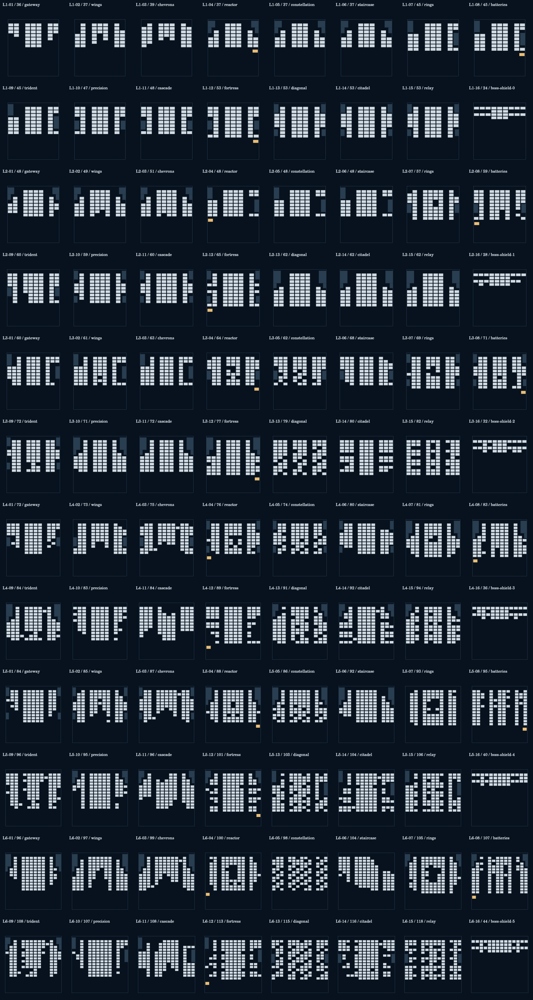
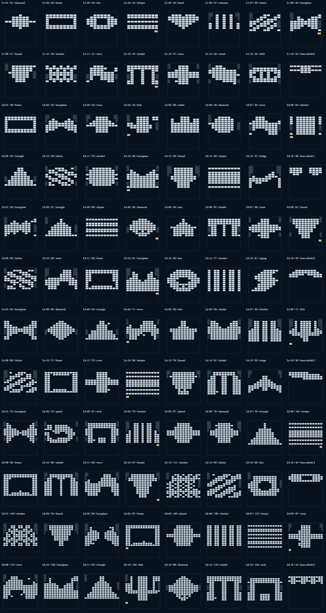

# Hybrid silhouettes — v5

Player observation: v3/v4 repeated the same vertical gaps and dense formations. The old layouts were sparser but had legible silhouettes, such as a heart, hourglass, diamond, frame, cross and scattered islands.

Intent: each screen should read as one distinct formation before launch. Reuse the old silhouette and negative space while keeping the newer campaign scale, arena bounds, progressive block/hit budgets and optional mechanics. Alternate wide/narrow, solid/hollow and symmetric/asymmetric screens; preserve the bottom reaction zone and more than one approach to the formation. Density is a pacing budget, never permission to fill the silhouette into a rectangle.

Geometry plan: remap authored legacy silhouettes onto larger grids; explicitly sculpt new motifs when the source is a plain slab; open local entrances rather than two permanent vertical empty columns; vary strokes and handedness across sectors. Preserve negative-space holes and separate islands. Fit side walls to each formation. Keep boss space and summon budget, paired portals, moving sweeps, chains, keys and optional caches valid. Do not modify progress IDs, reward claims or purchased cosmetics.

Validation order: compare geometry thumbnails and shape similarity, run structural/reachability audits and complete campaign simulations, then reuse the existing sci-fi rendering. Record before/after contact sheets and automated observations below. Human difficulty and timing remain provisional until device playtests.

## Delivered geometry

- 90 normal-stage binary footprints are distinct, organized into 25 silhouette families; adjacent normal stages do not repeat a family. Six boss shields also have different footprints. There are no normal stages retaining the former pair of permanent clear columns.
- Legacy resampling uses cell-area coverage so thin horizontal cross arms survive downsampling. Sparse structural strokes may widen by one neighbor cell. Dense slabs/relay carpets use authored arches, comet tails, rings, forks, wings or zigzags instead. No random infill is allowed simply to meet a density target.
- All six picture stages derive their actual occupied cells from the old picture masks (heart/castle/star/planet), not a generic constellation filled with colored bricks.
- Normal-stage mean target counts by sector: 41.5, 53.9, 62.7, 73.5, 86.4, 101.5. Per-stage contrast is deliberate; progression is a rising chapter envelope with recovery beats rather than a mandatory count increase on every stage.
- First-volley mastery is assigned only to formations with windows / islands / gaps; solid formations use perfect catches at those beats.
- Stage IDs, progress/economy identities and optional reward claim IDs remain compatible. The 18 caches, 96 mastery goals and five post-boss offers remain active.

## Before / after evidence

The player's observation above drove the change. These geometry-only contact sheets show the previous dense campaign beside the mixed silhouette campaign. They are generated from actual engine coordinates; these are not browser or device screenshots.

Inspect all three sources interactively in Level Lab: Original / Dense / Combined. Preview buttons always launch the combined runtime in practice mode; selecting a comparison does not change campaign state.

## Verification

- 96 structural audits: cell bounds, target counts/reachability, brick-wall/moving-sweep overlap, valid chains/electric groups/portal pairs and increasing chapter means.
- Seven new silhouette regression checks cover distinct footprints/families, removal of forced lanes, retained cross arms, picture/progress compatibility, unique boss shields, portal/moving reservations and density pacing.
- Existing tests pass: 20 engine, seven level/boss, 11 optional choices and 15 DOM integration checks (60 total including the new silhouette tests).
- Two independent fixed-step seeds: 192/192 runs ended; 190 wins, two boss losses, zero 300-second timeouts. Every stage won at least once. Seed 1 median/p90 winning time 63.85/97.45 seconds; seed 2 65.65/100.43 seconds. This aiming controller does not establish human success rates or play duration. Reports: `block-level-simulation-hybrid-1.json` and `block-level-simulation-hybrid-2.json`.
- Deterministic rebuild run twice produced identical level bytes.
- 547 atlas mappings, all six boss renderers, all owned skins/20 boosters and cache-warning-deflector states passed native Canvas rendering. Level Lab's three comparison tabs, 96 previews, simulation selector and embedded practice startup passed DOM smoke checks.

Remaining validation: browser/mobile layout and touch performance, novice recognition of formations, and human stage timing. No browser or device playtest is claimed. All timing/density targets are provisional design tuning. Existing sci-fi art is reused after geometry validation; no texture or animation redesign is included.
